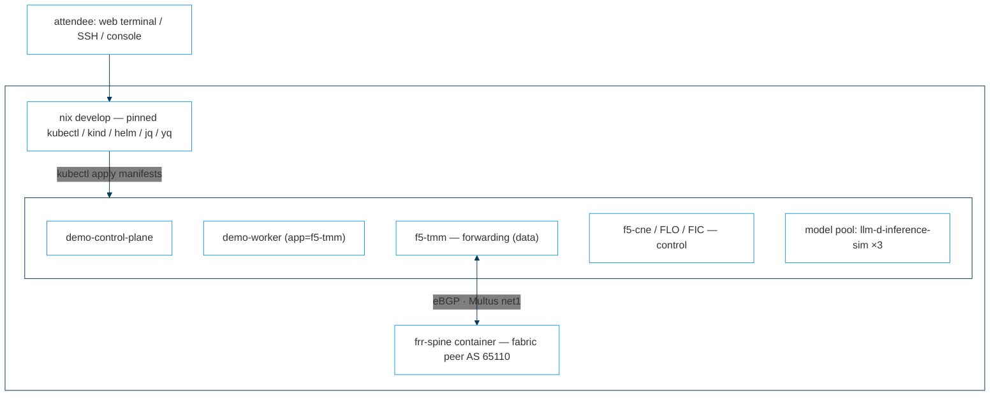

# ai-infra-for-neteng

Self-bootstrapping lab repository for **AI Infrastructure for Network Engineers** — an
instructor-led, hands-on course that takes Cisco/Juniper network engineers (fluent in
IP/MPLS and BIG-IP LTM, new to Kubernetes) to designing, deploying, and troubleshooting
AI-era ingress and load balancing on BIG-IP Next for Kubernetes (BNK) 2.4: BGP/VRF/EVPN
routing via CRDs, Gateway API, traditional L4/LB and firewall services, and AI inference
routing with InferencePool and the F5 Endpoint Picker (F5EPP) — finishing with a shared,
metered, policy-enforced model service.

Everything is declarative: custom resources in Git, applied by hand, verified through
status conditions and `tmctl` tables. The lab environment boots itself from this
repository on one Linux VM.

## Quickstart (every attendee / self-paced student)

Each course attendee receives a freshly booted lab instance (linux/amd64 with Docker and
Nix preinstalled; 16 vCPU / 32 GB RAM / 160 GB disk recommended;
[sizing](PLAN.md#2-lab-architecture)) and bootstraps their own environment at course
start — over SSH, a web terminal, or a console, identically:

```text
git clone https://github.com/shsingh/ai-infra-for-neteng.git
cd ai-infra-for-neteng
nix run .#bootstrap      # stands up kind + BNK 2.4.0 (demo mode) + fabric spine; 10–20 min
nix develop              # pinned shell: kubectl, kind, helm, jq, yq; KUBECONFIG set
nix run .#doctor         # green board = environment ready
```

Two credential files (an F5 image-pull secret tarball and a license JWT) are required in
`keys/` before bootstrap — see [FACILITATOR.md](FACILITATOR.md). They are never committed.

Offline/airgapped delivery is supported end to end:
[network-isolated bootstrap](PLAN.md#821-offline-bootstrap-self-sustained-vm).

## What's in the repository

| Path | Contents |
|---|---|
| [AGENTS.md](AGENTS.md) | Operating contract for build agents (Claude, Antigravity, or any coding agent) |
| [PLAN.md](PLAN.md) | The full build plan: architecture, pins, per-manifest specs, stages, acceptance gates |
| [FACILITATOR.md](FACILITATOR.md) | Run order, credentials, fault-drill commands, version ledger |
| [CONTRIBUTING.md](CONTRIBUTING.md) / [SECURITY.md](SECURITY.md) | Working agreement (Conventional Commits, signed commits) / private vulnerability reporting |
| [docs/course/](docs/course/README.md) | The content system of record: case study, teaching model, per-module scripts |
| `apps/`, `manifests/`, `fabric/`, `pkgs/` (built in stages) | Nix apps, lab manifests, FRR fabric peer, pinned packages |
| `docs/` (built in stages) | Student lab guides + the locally renderable site (`nix run .#docs`) |

## The lab in one picture



Full environment diagrams (three planes, module sequence, offline flow, build stages):
[docs/lab-environment.md](docs/lab-environment.md).

## The modules

Ten core modules (Kubernetes for network engineers → install → BGP/VRF/EVPN routing →
Gateway API → traditional LB → AI inference routing with the endpoint picker →
observability) plus four optional extensions (a management GUI, an OSS-vs-commercial
capability assessment, prompt screening at the edge, shared-model metering and
protection). The scenario and per-module scripts: [docs/course/case-study.md](docs/course/case-study.md).

## Status

The repository is in early build (see the [stage tracker](AGENTS.md#current-status)):
governance and the build plan are in place; the environment automation, manifests, and
lab guides land stage by stage, each verified against a running environment before merge.
