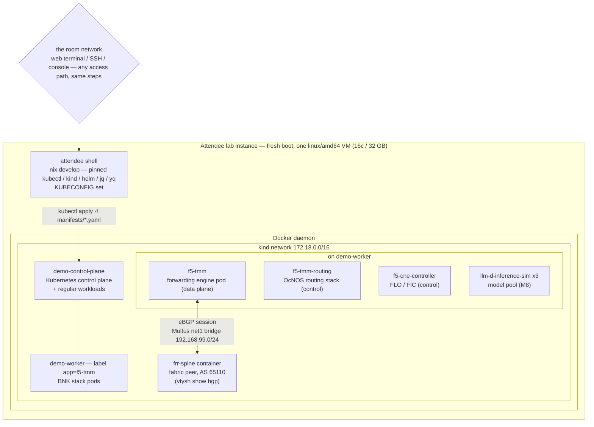
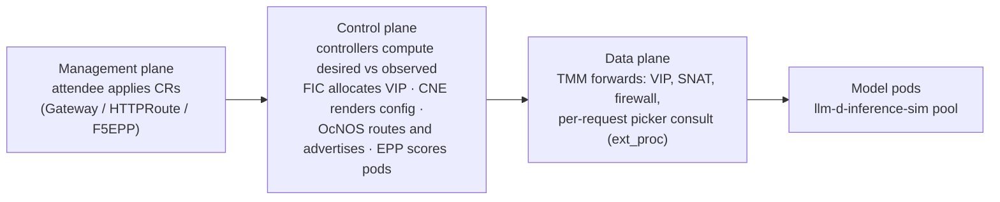
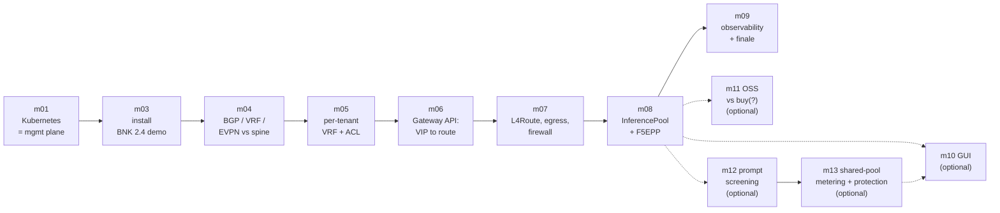
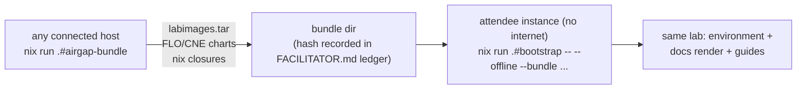
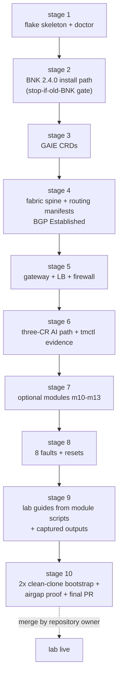

# Lab Environment Architecture

The complete lab runs on ONE Linux amd64 VM per attendee: the two Kubernetes nodes are
containers (kind), the fabric spine is a container, and traffic clients are pods — nothing
outside the VM. See [PLAN.md](https://github.com/shsingh/ai-infra-for-neteng/blob/master/PLAN.md#2-lab-architecture) for sizing and the address plan.

## Attendee instance and environment shape

## The three planes a request crosses (m06 preview)

## Module walk (the course arc)

## Offline / restricted-room flow

## Repository build stages (what the build agent verifies, in order)

Notes: GitHub renders these in markdown directly; the Sphinx site renders the identical
fences (MyST `myst_fence_as_directive` + sphinxcontrib-mermaid). When Stage 9 generates
real guides, module diagrams may move into the module scripts
([docs/course/modules](https://github.com/shsingh/ai-infra-for-neteng/tree/master/docs/course/modules)) — these stay here as the environment
overview.
